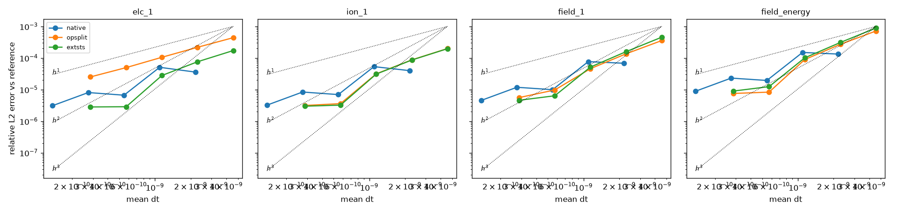

# Temporal convergence, `rt_gk_sheath_2x2v_p1`

Made by `convergence.py` on 2026-10-28 on math28, fork commit `85ed9cb86`; t_end = 2e-06, jobs = 16 (runs were concurrent, so wall times are indicative only).

Level = factor applied to both `cfl_frac` (1) and `cfl_frac_omegaH` (1.7); the step is the CFL-set step of the explicit terms at that level. Reference: native SSP-RK3 at level 1/128 (116787 steps, 576.0 s). Errors: relative L2 norm of the final frame (t = t_end) against the reference, and relative error of the final field energy; order = log(err ratio)/log(dt ratio) between consecutive levels.

**native** (expected order 3)

| level | steps | mean dt | wall (s) | elc_1 err | order | ion_1 err | order | field_1 err | order | field_energy err | order |
|---|---|---|---|---|---|---|---|---|---|---|---|
| 1 | 913 | 2.191e-09 | 5.4 | 3.58e-05 | - | 3.98e-05 | - | 6.81e-05 | - | 1.33e-04 | - |
| 1/2 | 1826 | 1.095e-09 | 10.2 | 5.07e-05 | -0.50 | 5.33e-05 | -0.42 | 7.67e-05 | -0.17 | 1.50e-04 | -0.17 |
| 1/4 | 3650 | 5.479e-10 | 19.6 | 6.65e-06 | 2.93 | 6.95e-06 | 2.94 | 9.94e-06 | 2.95 | 1.94e-05 | 2.95 |
| 1/8 | 7300 | 2.740e-10 | 38.3 | 8.06e-06 | -0.28 | 8.38e-06 | -0.27 | 1.18e-05 | -0.25 | 2.31e-05 | -0.25 |
| 1/16 | 14599 | 1.370e-10 | 74.2 | 3.10e-06 | 1.38 | 3.21e-06 | 1.38 | 4.54e-06 | 1.38 | 8.86e-06 | 1.38 |

**opsplit** (expected order 1)

| level | steps | mean dt | wall (s) | elc_1 err | order | ion_1 err | order | field_1 err | order | field_energy err | order |
|---|---|---|---|---|---|---|---|---|---|---|---|
| 1 | 438 | 4.566e-09 | 6.6 | 4.39e-04 | - | 1.99e-04 | - | 3.56e-04 | - | 7.16e-04 | - |
| 1/2 | 875 | 2.286e-09 | 9.0 | 2.18e-04 | 1.01 | 8.73e-05 | 1.19 | 1.36e-04 | 1.39 | 2.71e-04 | 1.40 |
| 1/4 | 1749 | 1.144e-09 | 13.4 | 1.05e-04 | 1.05 | 3.14e-05 | 1.47 | 4.60e-05 | 1.56 | 8.92e-05 | 1.61 |
| 1/8 | 3497 | 5.719e-10 | 25.6 | 4.97e-05 | 1.08 | 3.60e-06 | 3.13 | 9.73e-06 | 2.24 | 8.31e-06 | 3.42 |
| 1/16 | 6994 | 2.860e-10 | 49.0 | 2.52e-05 | 0.98 | 3.15e-06 | 0.19 | 5.58e-06 | 0.80 | 7.54e-06 | 0.14 |

**extsts** (expected order 2)

| level | steps | mean dt | wall (s) | elc_1 err | order | ion_1 err | order | field_1 err | order | field_energy err | order |
|---|---|---|---|---|---|---|---|---|---|---|---|
| 1 | 438 | 4.566e-09 | 5.0 | 1.72e-04 | - | 1.97e-04 | - | 4.55e-04 | - | 8.87e-04 | - |
| 1/2 | 875 | 2.286e-09 | 9.5 | 7.60e-05 | 1.18 | 8.63e-05 | 1.19 | 1.59e-04 | 1.52 | 3.10e-04 | 1.52 |
| 1/4 | 1749 | 1.144e-09 | 18.5 | 2.79e-05 | 1.45 | 3.09e-05 | 1.48 | 5.16e-05 | 1.62 | 1.01e-04 | 1.62 |
| 1/8 | 3497 | 5.719e-10 | 35.9 | 2.87e-06 | 3.28 | 3.22e-06 | 3.26 | 6.38e-06 | 3.02 | 1.24e-05 | 3.03 |
| 1/16 | 6994 | 2.860e-10 | 68.7 | 2.82e-06 | 0.02 | 2.99e-06 | 0.11 | 4.59e-06 | 0.47 | 8.98e-06 | 0.47 |

