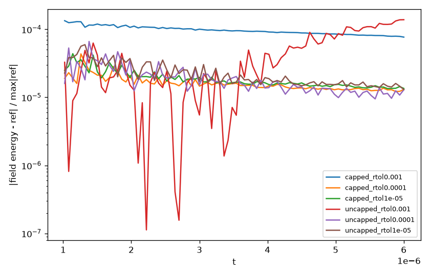

# Adaptive ExtSTS tolerance sweep, `rt_gk_sheath_2x2v_p1`

Made by `tolerance_sweep.py` on 2026-10-27 on math28, fork commit `2eeb5908a`. ExtSTS = MRI GKC21 outer + RKL inner, Soderlind controller; reference = native SSP-RK3 (`ref/`). Differences are max relative differences of the integrated diagnostics for t > 1e-6.

Cases: capped = input file as is (cfl_frac = 1); uncapped = cfl_frac = 10, cfl_frac_omegaH = 17.

| case | rtol | steps | attempts | err fails | stab. lim. | acc. lim. | wall (s) | field E | elc moms | ion moms | elc bflux | ion bflux |
|---|---|---|---|---|---|---|---|---|---|---|---|---|
| capped | 0.001 | 1364 | 1365 | 1 | 1338 | 27 | 13.8 | 1.3e-04 | 1.5e-05 | 1.8e-05 | 4.1e-05 | 1.1e-04 |
| capped | 0.0001 | 1450 | 1452 | 2 | 1293 | 159 | 14.5 | 4.4e-05 | 1.4e-06 | 1.8e-07 | 4.7e-05 | 5.4e-05 |
| capped | 1e-05 | 1735 | 1737 | 2 | 1219 | 518 | 17.1 | 4.4e-05 | 1.6e-06 | 1.8e-07 | 5.1e-05 | 5.5e-05 |
| uncapped | 0.001 | 656 | 719 | 63 | 0 | 719 | 7.4 | 1.4e-04 | 4.2e-06 | 2.5e-07 | 3.1e-04 | 3.0e-04 |
| uncapped | 0.0001 | 770 | 826 | 56 | 0 | 826 | 8.5 | 6.6e-05 | 3.4e-06 | 2.5e-07 | 1.9e-04 | 3.1e-04 |
| uncapped | 1e-05 | 1106 | 1155 | 49 | 0 | 1155 | 11.6 | 6.0e-05 | 2.6e-06 | 2.3e-07 | 1.2e-04 | 2.7e-04 |

